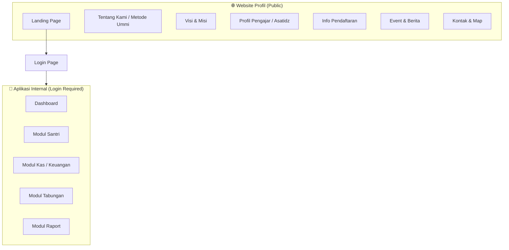
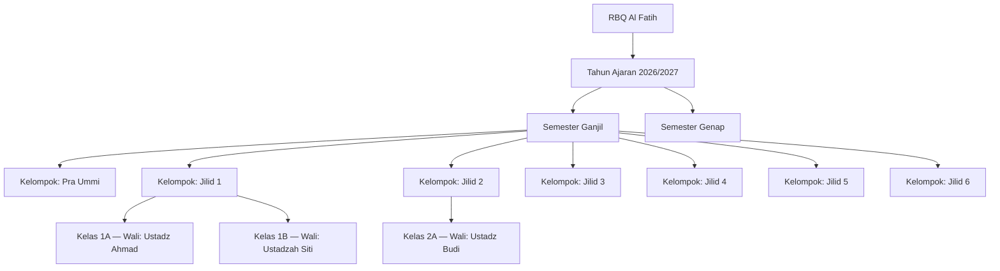
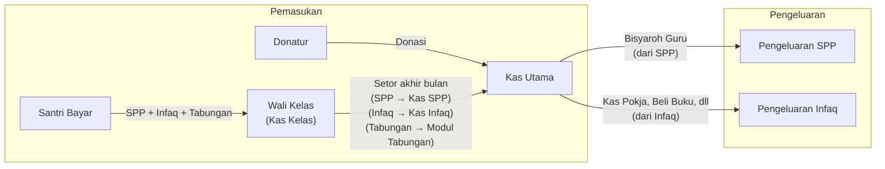
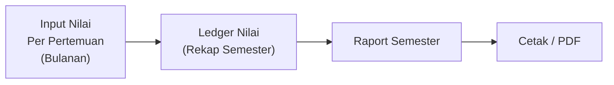

# 📋 Product Requirements Document (PRD)
# Rumah Belajar Quran (RBQ) Al Fatih — Web Application

---

> **Versi**: 1.2
> **Tanggal**: 18 Oktober 2026
> **Author**: AI-Generated from `kebutuhan.txt`
> **Status**: Updated — Penambahan Spesifikasi Profil Pengajar (Asatidz)
> **Changelog**: v1.2 — Penambahan spesifikasi direktori profil pengajar profesional (foto, almamater/pendidikan, lisensi Ummi, pengalaman, skill badges, UI/UX interaktif) pada Website Profil publik

---

## 1. Ringkasan Produk

### 1.1 Deskripsi Singkat
Aplikasi web untuk **Rumah Belajar Quran (RBQ) Al Fatih** yang terdiri dari dua bagian utama:
1. **Website Profil (Public)** — Landing page publik berisi informasi tentang RBQ Al Fatih.
2. **Aplikasi Internal (Private/Auth)** — Sistem manajemen internal yang diakses setelah login, mencakup modul Santri, Kas/Keuangan, Tabungan, dan Raport.

### 1.2 Metode Pengajaran
RBQ Al Fatih menggunakan **Metode Ummi** untuk pengajaran Al-Quran. Metode ini membagi progress belajar santri ke dalam kelompok/jilid secara berjenjang.

### 1.3 Target Pengguna

| Peran | Deskripsi | Akses |
|---|---|---|
| **Pengunjung (Public)** | Calon wali santri, masyarakat umum | Website profil saja |
| **Admin** | Pengelola RBQ Al Fatih | Semua modul (master data, user, santri, kelas, tahun ajaran, event/berita) |
| **Keuangan** | Petugas keuangan RBQ Al Fatih | Modul Kas (pengeluaran kas utama, donasi, laporan keuangan, terima setoran wali kelas) |
| **Wali Kelas (Ustadz/ah)** | Guru yang ditugaskan sebagai wali kelas | Modul Kas (input pembayaran kelas sendiri, setor ke kas utama), Modul Raport (input nilai kelas sendiri) |

---

## 2. Arsitektur Sistem (High-Level)



---

## 3. Modul 1 — Website Profil (Public)

### 3.1 Tujuan
Menampilkan informasi publik tentang RBQ Al Fatih untuk calon wali santri dan masyarakat umum, membangun rasa percaya (trust & credibility) terhadap mutu pembelajaran Al-Quran dengan Metode Ummi dan kualitas tenaga pengajar (asatidz).

### 3.2 Halaman & Konten

| Halaman | Konten | Catatan |
|---|---|---|
| **Home / Landing** | Hero section, highlight keunggulan, statistik santri, preview pengajar, CTA pendaftaran | Halaman pertama yang dilihat pengunjung |
| **Tentang Kami** | Profil RBQ Al Fatih, penjelasan Metode Ummi, sejarah singkat, legalitas | Jelaskan bahwa pengajaran menggunakan **Metode Ummi** |
| **Visi & Misi** | Visi, misi, dan nilai-nilai dasar RBQ Al Fatih | — |
| **Profil Pengajar (Asatidz)** | Direktori tenaga pengajar profesional lengkap dengan foto, pendidikan, lisensi/sertifikasi Ummi, pengalaman mengajar, dan spesialisasi jilid/tahfidz | Layout grid card modern dengan filter kategori dan modal detail |
| **Info Pendaftaran** | Persyaratan, jadwal pendaftaran, alur pendaftaran, rincian biaya | Dilengkapi formulir registrasi awal & link WhatsApp center |
| **Event & Berita** | Daftar kegiatan, dokumentasi munaqosyah/wisuda, artikel dakwah | Thumbnail, tanggal publikasi, kategori, dan detail artikel |
| **Kontak** | Alamat lengkap, nomor WhatsApp resmi, email, jam operasional, Google Maps embed | Maps URL: `https://maps.app.goo.gl/6aJ7jQ7tJwVJyrQF7` |

### 3.3 Spesifikasi Profil Tenaga Pengajar (Asatidz) Profesional

Untuk memberikan kesan profesional, kredibel, dan terpercaya bagi calon wali santri, bagian **Profil Pengajar** dirancang dengan standar web profil modern:

#### A. Komponen Data Tiap Pengajar
1. **Foto Profil Profesional**:
   - Foto resolusi tinggi bernuansa islami formal (rapi, berbusana syar'i, latar foto seragam/netral).
2. **Identitas & Gelar**:
   - Nama lengkap beserta gelar akademik/syar'i (contoh: *Ustadz Ahmad Fauzi, S.Pd.I, Al-Hafizh*).
   - Peran di RBQ (contoh: *Kepala Pengajar*, *Koordinator Tahfidz*, *Wali Kelas Jilid 3*).
3. **Pendidikan Terakhir (Almamater)**:
   - Riwayat pesantren, ma'had 'ali, atau perguruan tinggi islam (contoh: *S1 Pendidikan Agama Islam - Universitas PTIQ Jakarta*, *Alumni Ma'had Tahfizhul Quran Al-Hikmah*).
4. **Sertifikasi & Sanad Al-Quran**:
   - Lisensi Guru Al-Quran Metode Ummi (Tashih & Tahsin Ummi Foundation).
   - Syahadah Tahfidz 30 Juz / Sanad Qira'at Riwayat Hafs 'an 'Ashim (jika memiliki).
   - Sertifikasi Diklat Standarisasi Guru Al-Quran.
5. **Pengalaman Mengajar & Portofolio**:
   - Durasi pengalaman mengajar tahsin dan tahfidz anak/dewasa (contoh: *5+ tahun membina tahsin anak*).
   - Rekam jejak keberhasilan mengantarkan santri wisuda tahfidz & munaqosyah.
6. **Keahlian & Spesialisasi (Skill Badges)**:
   - Tag/badge keahlian, misal: `Metode Ummi Certified`, `Makharijul Huruf`, `Tahfidz Juz 30 & 29`, `Pendekatan Karakter Anak`, `Ghorib & Tajwid`.
7. **Quote / Visi Pengajar**:
   - Kalimat motivasi atau mutiara hikmah dari asatidz mengenai pentingnya adab dan cinta Al-Quran sejak dini.
8. **Media Sosial & Kontak Resmi**:
   - Tautan LinkedIn / Instagram profesional atau kontak konsultasi pembelajaran.

#### B. Fitur Tampilan (UI/UX)
- **Interactive Teacher Cards**: Kartu profil dengan efek hover interaktif, menampilkan foto, nama, badge sertifikasi, dan ringkasan singkat.
- **Filter Kategori Pengajar**: Pilihan tombol filter (misal: *Semua*, *Pengajar Ikhwan*, *Pengajar Akhwat*, *Divisi Tahfidz*, *Divisi Tahsin Ummi*).
- **Modal Pop-Up Detail Profil**: Klik kartu untuk memunculkan detail lengkap (riwayat pendidikan, daftar sertifikasi, pengalaman mengajar, dan quote pengajar) tanpa reload halaman.

### 3.4 Persyaratan Non-Fungsional
- **Responsive Design**: Wajib optimal di perangkat mobile (HP), tablet, dan desktop (laptop).
- **SEO Friendly**: Struktur meta tags, semantic HTML5, Schema.org Person metadata.
- **Fast Loading & Image Optimization**: Format gambar terkompresi (WebP/JPEG) dengan lazy loading agar tetap cepat diakses di jaringan mobile.

---

## 4. Modul 2 — Autentikasi (Login)

### 4.1 Tujuan
Mengamankan akses ke aplikasi internal RBQ.

### 4.2 Fitur

| Fitur | Deskripsi |
|---|---|
| **Login** | Form login dengan username/email dan password |
| **Logout** | Keluar dari sesi |
| **Role-Based Access Control (RBAC)** | Membedakan akses berdasarkan peran (Admin, Keuangan, Wali Kelas) |
| **Manajemen User** | Admin dapat membuat, mengedit, dan menonaktifkan akun user serta assign role |

### 4.3 Peran & Hak Akses

| Fitur | Admin | Keuangan | Wali Kelas |
|---|---|---|---|
| Manajemen Santri | ✅ Semua | ❌ | ❌ |
| Manajemen Kelas & Kelompok | ✅ Semua | ❌ | ❌ |
| Manajemen Tahun Ajaran & Semester | ✅ | ❌ | ❌ |
| Input Pembayaran Santri | ❌ | ❌ | ✅ Kelas sendiri saja |
| Setor Kas ke Kas Utama | ❌ | ✅ Terima setoran | ✅ Kelas sendiri |
| Pengeluaran Kas Utama | ❌ | ✅ | ❌ |
| Input Donasi | ❌ | ✅ | ❌ |
| Laporan Keuangan | ✅ Lihat | ✅ Kelola & Lihat | ❌ |
| Riwayat Transaksi | ✅ Lihat | ✅ Lihat | ✅ Kelas sendiri |
| Input Nilai Raport | ❌ | ❌ | ✅ Kelas sendiri saja |
| Lihat Raport | ✅ Semua | ❌ | ✅ Kelas sendiri |
| Manajemen Tabungan | ✅ | ✅ | ❌ |
| Manajemen User | ✅ | ❌ | ❌ |
| Manajemen Event & Berita | ✅ | ❌ | ❌ |
| Dashboard | ✅ Semua widget | ✅ Widget keuangan | ✅ Widget kelas sendiri |

---

## 5. Modul 3 — Santri

### 5.1 Tujuan
Mengelola data santri secara lengkap termasuk riwayat perubahan jilid dan pengelompokan kelas.

### 5.2 Struktur Kelompok & Kelas



**Daftar Kelompok (Jenjang):**
1. Pra Ummi
2. Jilid 1
3. Jilid 2
4. Jilid 3
5. Jilid 4
6. Jilid 5
7. Jilid 6

**Aturan:**
- 1 kelompok **bisa terdiri dari beberapa kelas**.
- Setiap kelas memiliki **1 wali kelas**.
- Wali kelas **bisa berubah** setiap tahun ajaran baru.

### 5.3 Fitur

| Fitur | Deskripsi |
|---|---|
| **Tambah Santri Baru** | Input data santri baru (nama, tanggal lahir, alamat, nama wali, no. HP wali, foto, dll.) |
| **Profil Santri** | Halaman detail santri: data pribadi, kelompok/jilid saat ini, kelas, wali kelas, riwayat jilid, status |
| **Santri Keluar** | Menandai santri sebagai keluar (soft delete), dengan tanggal dan alasan keluar |
| **Riwayat Jilid** | Setiap perubahan jilid/kelompok santri **tercatat** di sistem dengan timestamp |
| **Filter by Tahun Ajaran & Semester** | Melihat daftar santri berdasarkan tahun ajaran dan semester tertentu |
| **Manajemen Kelas** | CRUD kelas per semester, assign santri ke kelas, assign wali kelas |
| **Manajemen Tahun Ajaran** | Buat tahun ajaran baru, set tahun ajaran aktif |
| **Manajemen Semester** | Buat semester (Ganjil/Genap) dalam tahun ajaran, set semester aktif |

### 5.4 Data Model — Santri

```
Santri {
    id: UUID
    nama_lengkap: string
    nama_panggilan: string
    tempat_lahir: string
    tanggal_lahir: date
    jenis_kelamin: enum (L/P)
    alamat: text
    nama_wali: string
    no_hp_wali: string
    foto: string (path/url)
    tanggal_masuk: date
    tanggal_keluar: date (nullable)
    alasan_keluar: text (nullable)
    status: enum (aktif, keluar)
    created_at: timestamp
    updated_at: timestamp
}

Kelompok {
    id: UUID
    nama: string  // "Pra Ummi", "Jilid 1", dst.
    urutan: integer
}

TahunAjaran {
    id: UUID
    nama: string  // "2026/2027"
    tanggal_mulai: date
    tanggal_selesai: date
    is_aktif: boolean
}

Semester {
    id: UUID
    tahun_ajaran_id: FK → TahunAjaran
    tipe: enum (ganjil, genap)
    tanggal_mulai: date
    tanggal_selesai: date
    is_aktif: boolean
}

Kelas {
    id: UUID
    nama: string  // "Kelas 1A"
    kelompok_id: FK → Kelompok
    semester_id: FK → Semester  // Kelas terikat ke semester
    wali_kelas_id: FK → User
}

KelasSantri {
    id: UUID
    kelas_id: FK → Kelas
    santri_id: FK → Santri
    tanggal_masuk_kelas: date
    tanggal_keluar_kelas: date (nullable)
}

RiwayatJilid {
    id: UUID
    santri_id: FK → Santri
    kelompok_id: FK → Kelompok
    semester_id: FK → Semester  // Perubahan jilid tercatat per semester
    tanggal_perubahan: date
    keterangan: text (nullable)
}

User {
    id: UUID
    nama: string
    username: string
    email: string
    password: string (hashed)
    role: enum (admin, keuangan, wali_kelas)
    is_active: boolean
    created_at: timestamp
    updated_at: timestamp
}
```

---

## 6. Modul 4 — Kas / Keuangan

### 6.1 Tujuan
Mengelola keuangan RBQ Al Fatih termasuk pembayaran santri, donasi, dan pengeluaran.

### 6.2 Alur Keuangan



### 6.3 Kategori Pembayaran Santri

| Kategori | Sifat Nominal | Keterangan |
|---|---|---|
| **SPP** | **Tetap** (fixed amount) | Nominal ditentukan oleh admin, sama untuk semua santri |
| **Infaq** | **Bebas** (flexible) | Nominal terserah wali santri |
| **Tabungan** | **Bebas** (flexible) | Bisa diambil kembali oleh santri, masuk ke Modul Tabungan |

### 6.4 Alur Pembayaran

1. Santri membayar ke **wali kelas** (bisa sebagian atau seluruh kategori).
2. Wali kelas **menginput pembayaran** ke sistem setiap ada yang bayar.
3. Di **akhir bulan**, wali kelas **menyetorkan** seluruh uang ke **Kas Utama**.
4. Sistem mencatat setoran dan memindahkan saldo ke kas utama.

### 6.5 Sumber Pemasukan

| Sumber | Masuk ke | Keterangan |
|---|---|---|
| SPP Santri | Kas SPP | Dari pembayaran bulanan santri |
| Infaq Santri | Kas Infaq | Dari pembayaran bulanan santri |
| Tabungan Santri | Modul Tabungan | Terpisah, bisa ditarik santri |
| Donatur | Kas Infaq | Nominal bebas, bergabung dengan infaq |

### 6.6 Pengeluaran

| Jenis Pengeluaran | Sumber Dana | Contoh |
|---|---|---|
| Bisyaroh (honor) Guru | Kas **SPP** | Gaji bulanan ustadz/ah |
| Bayar Kas ke Pokja | Kas **Infaq** | Setoran ke kelompok kerja |
| Pembelian Buku | Kas **Infaq** | Buku jilid, alat tulis |
| Pengeluaran Lainnya | Kas **Infaq** | Operasional, dll. |

> [!IMPORTANT]
> Pengeluaran hanya dilakukan dari **Kas Utama** oleh peran **Keuangan**. Admin dapat melihat laporan tetapi tidak menginput pengeluaran. Wali Kelas tidak memiliki akses pengeluaran.

### 6.7 Fitur

| Fitur | Deskripsi | Aktor |
|---|---|---|
| **Input Pembayaran Santri** | Catat pembayaran per santri per bulan (SPP, Infaq, Tabungan) | Wali Kelas |
| **Rekap Pembayaran Kelas** | Lihat status pembayaran seluruh santri di kelas per bulan | Wali Kelas, Admin |
| **Setor ke Kas Utama** | Wali kelas setor uang yang terkumpul ke kas utama | Wali Kelas → diterima Keuangan |
| **Terima Setoran** | Konfirmasi penerimaan setoran dari wali kelas | Keuangan |
| **Input Donasi** | Catat pemasukan dari donatur | Keuangan |
| **Pengeluaran** | Catat pengeluaran dari kas utama (SPP/Infaq) | Keuangan |
| **Laporan Keuangan** | Ringkasan pemasukan, pengeluaran, saldo per periode | Keuangan, Admin (view) |
| **Riwayat Transaksi** | Log semua transaksi masuk dan keluar | Keuangan, Admin (view) |

### 6.8 Data Model — Kas

```
PembayaranSantri {
    id: UUID
    santri_id: FK → Santri
    kelas_id: FK → Kelas
    bulan: integer (1-12)
    tahun: integer
    nominal_spp: decimal
    nominal_infaq: decimal
    nominal_tabungan: decimal
    tanggal_bayar: date
    dicatat_oleh: FK → User (wali kelas)
    status_setor: enum (belum_setor, sudah_setor)
    created_at: timestamp
}

SetoranKasUtama {
    id: UUID
    kelas_id: FK → Kelas
    bulan: integer
    tahun: integer
    total_spp: decimal
    total_infaq: decimal
    total_tabungan: decimal
    tanggal_setor: date
    disetor_oleh: FK → User (wali kelas)
    diterima_oleh: FK → User (admin)
    created_at: timestamp
}

Donasi {
    id: UUID
    nama_donatur: string
    nominal: decimal
    tanggal: date
    keterangan: text
    dicatat_oleh: FK → User
    created_at: timestamp
}

Pengeluaran {
    id: UUID
    kategori_sumber: enum (spp, infaq)
    jenis_pengeluaran: string  // "Bisyaroh Guru", "Beli Buku", dll.
    nominal: decimal
    tanggal: date
    keterangan: text
    dicatat_oleh: FK → User (role: keuangan)
    disetujui_oleh: FK → User (nullable, untuk approval flow jika diperlukan)
    created_at: timestamp
}

NominalSPP {
    id: UUID
    nominal: decimal
    berlaku_mulai: date
    berlaku_sampai: date (nullable)
    is_aktif: boolean
}
```

---

## 7. Modul 5 — Tabungan

### 7.1 Tujuan
Mengelola tabungan santri yang dihimpun dari pembayaran bulanan dan bisa ditarik kembali.

### 7.2 Fitur

| Fitur | Deskripsi |
|---|---|
| **Saldo Tabungan** | Lihat saldo tabungan setiap santri |
| **Riwayat Transaksi** | Daftar transaksi tabungan masuk dan pengambilan per santri |
| **Tabungan Masuk** | Otomatis tercatat dari pembayaran santri (kolom tabungan) |
| **Pengambilan Tabungan** | Catat penarikan tabungan oleh santri |
| **Rekap Tabungan** | Ringkasan seluruh tabungan santri |

### 7.3 Data Model — Tabungan

```
TransaksiTabungan {
    id: UUID
    santri_id: FK → Santri
    tipe: enum (masuk, keluar)
    nominal: decimal
    saldo_setelah: decimal
    tanggal: date
    keterangan: text
    referensi_pembayaran_id: FK → PembayaranSantri (nullable, jika tipe=masuk)
    dicatat_oleh: FK → User
    created_at: timestamp
}
```

---

## 8. Modul 6 — Raport

### 8.1 Tujuan
Menginput nilai santri per pertemuan, menyusun ledger nilai, dan menghasilkan raport semester.

### 8.2 Alur Penilaian



### 8.3 Komponen Raport

| Komponen | Deskripsi | Detail |
|---|---|---|
| **Nilai Akademik** | Dari ledger nilai (pertemuan bulanan) | Nilai rata-rata atau akumulasi per mata pelajaran/aspek |
| **Penilaian Kepribadian** | Aspek non-akademik | 3 aspek: **Tertib**, **Disiplin**, **Motivasi Belajar** |
| **Skala Kepribadian** | Huruf | **A**, **B**, **C**, **D** |
| **Absensi** | Kehadiran selama 1 semester | **Sakit**, **Izin**, **Tanpa Keterangan** (jumlah hari) |
| **Peringkat** | Ranking santri dalam kelas | Dihitung otomatis dari ledger nilai |

### 8.4 Fitur

| Fitur | Deskripsi | Aktor |
|---|---|---|
| **Input Nilai Pertemuan** | Input nilai santri setiap pertemuan per bulan | Wali Kelas |
| **Ledger Nilai** | Rekap otomatis seluruh nilai per semester | Sistem (auto-generate) |
| **Input Kepribadian** | Input nilai kepribadian (Tertib, Disiplin, Motivasi Belajar) | Wali Kelas |
| **Input Absensi** | Input jumlah Sakit, Izin, Tanpa Keterangan per semester | Wali Kelas |
| **Hitung Peringkat** | Peringkat otomatis berdasarkan ledger nilai | Sistem (auto-calculate) |
| **Generate Raport** | Gabungkan semua komponen menjadi raport final | Admin / Wali Kelas |
| **Cetak / Export PDF** | Cetak raport dalam format PDF | Admin / Wali Kelas |

### 8.5 Data Model — Raport

```
NilaiPertemuan {
    id: UUID
    santri_id: FK → Santri
    kelas_id: FK → Kelas
    semester_id: FK → Semester  // Mengacu ke semester aktif
    bulan: integer (1-12)
    tahun: integer
    pertemuan_ke: integer
    nilai: decimal
    keterangan: text (nullable)
    diinput_oleh: FK → User
    created_at: timestamp
}

LedgerNilai {
    id: UUID
    santri_id: FK → Santri
    kelas_id: FK → Kelas
    semester_id: FK → Semester  // Mengacu ke tabel Semester
    nilai_rata_rata: decimal
    peringkat: integer
    created_at: timestamp
    updated_at: timestamp
}

Raport {
    id: UUID
    santri_id: FK → Santri
    kelas_id: FK → Kelas
    semester_id: FK → Semester  // Mengacu ke tabel Semester
    
    // Kepribadian
    nilai_tertib: enum (A, B, C, D)
    nilai_disiplin: enum (A, B, C, D)
    nilai_motivasi_belajar: enum (A, B, C, D)
    
    // Absensi
    jumlah_sakit: integer
    jumlah_izin: integer
    jumlah_tanpa_keterangan: integer
    
    // Dari Ledger
    nilai_rata_rata: decimal
    peringkat: integer
    
    catatan_wali_kelas: text (nullable)
    status: enum (draft, final)
    created_at: timestamp
    updated_at: timestamp
}
```

---

## 9. Dashboard

### 9.1 Tujuan
Halaman utama setelah login yang menampilkan ringkasan data penting.

### 9.2 Widget Dashboard

| Widget | Admin | Keuangan | Wali Kelas |
|---|---|---|---|
| Total Santri Aktif | ✅ | ❌ | ✅ (kelas sendiri) |
| Ringkasan Kas Bulan Ini | ✅ | ✅ | ✅ (kelas sendiri) |
| Santri Belum Bayar Bulan Ini | ✅ | ✅ | ✅ (kelas sendiri) |
| Saldo Kas (SPP, Infaq) | ✅ | ✅ | ❌ |
| Grafik Pemasukan/Pengeluaran | ✅ | ✅ | ❌ |
| Setoran Pending (belum diterima) | ❌ | ✅ | ❌ |
| Event / Berita Terbaru | ✅ | ✅ | ✅ |
| Info Semester & Tahun Ajaran Aktif | ✅ | ✅ | ✅ |

---

## 10. Persyaratan Non-Fungsional

| Aspek | Requirement |
|---|---|
| **Responsive** | Wajib mendukung tampilan mobile dan desktop |
| **Performance** | Halaman load < 3 detik |
| **Security** | Password hashing, session management, CSRF protection |
| **Backup** | Database backup berkala |
| **Browser Support** | Chrome, Firefox, Safari, Edge (versi terbaru) |
| **Bahasa** | Indonesia |

---

## 11. Tech Stack

| Layer | Teknologi | Alasan |
|---|---|---|
| **Backend Framework** | **CodeIgniter 3** (PHP) | Familiar bagi developer, ringan, cepat, MVC pattern |
| **Frontend View** | CodeIgniter Views (PHP) + Bootstrap 4/5 | Server-side rendering, responsive, cepat develop |
| **Styling** | Bootstrap + Custom CSS | Komponen UI siap pakai, responsive grid |
| **JavaScript** | jQuery (bawaan CI3) + DataTables | Interaktif, tabel dinamis, AJAX |
| **Database** | MySQL | Default di Laragon, relational, cocok dengan data model |
| **Authentication** | Custom Auth Library (CI3 Session) | Session-based auth dengan RBAC |
| **PDF Export** | DomPDF / TCPDF | Untuk cetak raport |
| **Charts** | Chart.js | Grafik dashboard (pemasukan/pengeluaran) |
| **Maps** | Google Maps Embed API | Untuk halaman kontak |
| **Server** | Laragon (Apache + MySQL + PHP) | Sudah tersedia, zero-config |

> [!TIP]
> Project path: `c:\laragon\www\rbq_alfatih\` — langsung bisa diakses via `http://rbq_alfatih.test` jika Laragon Pretty URL diaktifkan.

### 11.1 Struktur Folder CodeIgniter 3

```
rbq_alfatih/
├── application/
│   ├── config/          # Konfigurasi (database, routes, autoload)
│   ├── controllers/     # Controller per modul
│   │   ├── Auth.php
│   │   ├── Dashboard.php
│   │   ├── Santri.php
│   │   ├── Kelas.php
│   │   ├── Kas.php
│   │   ├── Tabungan.php
│   │   ├── Raport.php
│   │   ├── TahunAjaran.php
│   │   ├── Profil.php       # Website publik
│   │   └── Berita.php
│   ├── models/          # Model per tabel
│   │   ├── Santri_model.php
│   │   ├── Kelas_model.php
│   │   ├── Kas_model.php
│   │   ├── Tabungan_model.php
│   │   ├── Raport_model.php
│   │   ├── User_model.php
│   │   ├── TahunAjaran_model.php
│   │   └── Semester_model.php
│   ├── views/           # View (template)
│   │   ├── layout/      # Master template (header, footer, sidebar)
│   │   ├── auth/
│   │   ├── dashboard/
│   │   ├── santri/
│   │   ├── kelas/
│   │   ├── kas/
│   │   ├── tabungan/
│   │   ├── raport/
│   │   └── public/      # Halaman website profil
│   ├── libraries/       # Custom library (Auth, RBAC)
│   ├── helpers/         # Custom helper functions
│   └── third_party/     # Library pihak ketiga (DomPDF, dll)
├── assets/              # CSS, JS, images, fonts
│   ├── css/
│   ├── js/
│   ├── img/
│   └── vendor/          # Bootstrap, jQuery, DataTables, Chart.js
└── system/              # Core CodeIgniter 3 (JANGAN diedit)
```

---

## 12. Standar Kode & Dokumentasi (Clean Code)

> [!IMPORTANT]
> Seluruh kode yang ditulis **WAJIB** mengikuti standar ini agar mudah dilanjutkan oleh programmer berikutnya.

### 12.1 Prinsip Clean Code

| Prinsip | Penjelasan |
|---|---|
| **Meaningful Names** | Nama variabel, fungsi, class harus deskriptif dan jelas tujuannya |
| **Single Responsibility** | Setiap fungsi hanya melakukan **satu hal** |
| **Small Functions** | Fungsi tidak boleh terlalu panjang (maks ~30 baris logic) |
| **DRY (Don't Repeat Yourself)** | Hindari duplikasi kode, gunakan helper/library |
| **Consistent Formatting** | Indentasi konsisten (4 spaces/tab), brace style konsisten |

### 12.2 Standar Komentar — Wajib di Setiap Fungsi

Setiap fungsi **WAJIB** memiliki docblock comment dengan format berikut:

```php
/**
 * Menyimpan data pembayaran santri ke database
 *
 * Fungsi ini mencatat pembayaran bulanan santri yang terdiri dari
 * SPP, Infaq, dan Tabungan. Dipanggil oleh wali kelas saat
 * menerima pembayaran dari santri.
 *
 * @param  int    $santri_id   ID santri yang membayar
 * @param  int    $kelas_id    ID kelas santri
 * @param  array  $data        Data pembayaran ['spp', 'infaq', 'tabungan']
 * @return bool                True jika berhasil disimpan
 *
 * @author  [Nama Developer]
 * @since   v1.0
 */
public function simpan_pembayaran($santri_id, $kelas_id, $data)
{
    // Validasi input
    // ...

    // Simpan ke tabel pembayaran_santri
    // ...

    // Otomatis catat tabungan ke modul tabungan
    // ...
}
```

### 12.3 Standar Penamaan (CodeIgniter 3)

| Elemen | Konvensi | Contoh |
|---|---|---|
| **Controller** | PascalCase, singular | `Santri.php`, `Kas.php` |
| **Model** | PascalCase + `_model` | `Santri_model.php` |
| **Method/Function** | snake_case, verb-first | `get_santri_by_id()`, `simpan_pembayaran()` |
| **Variable** | snake_case | `$santri_id`, `$total_spp` |
| **Tabel Database** | snake_case, plural | `santri`, `kelas`, `pembayaran_santri` |
| **View** | snake_case | `daftar_santri.php`, `form_pembayaran.php` |
| **Konstanta** | UPPER_SNAKE_CASE | `ROLE_ADMIN`, `STATUS_AKTIF` |

### 12.4 Standar Controller

```php
/**
 * Controller Santri
 *
 * Mengelola semua operasi terkait data santri:
 * - Menampilkan daftar santri
 * - Menambah santri baru
 * - Mengubah data santri
 * - Menandai santri keluar
 * - Melihat riwayat jilid
 *
 * @package    RBQ Al Fatih
 * @subpackage Controllers
 * @category   Santri
 * @author     [Nama Developer]
 */
class Santri extends CI_Controller
{
    public function __construct()
    {
        parent::__construct();
        // Cek autentikasi — hanya role admin yang boleh akses
        $this->load->library('auth');
        $this->auth->check_login();
        $this->auth->check_role(['admin']);

        // Load model yang dibutuhkan
        $this->load->model('Santri_model');
    }
}
```

### 12.5 Standar Model

```php
/**
 * Model Santri
 *
 * Berisi semua query database terkait tabel `santri`.
 * Setiap method mengembalikan data dalam bentuk array atau object.
 *
 * @package    RBQ Al Fatih
 * @subpackage Models
 * @category   Santri
 * @author     [Nama Developer]
 */
class Santri_model extends CI_Model
{
    /** @var string Nama tabel utama */
    private $table = 'santri';

    /**
     * Mengambil semua santri aktif berdasarkan semester
     *
     * @param  int   $semester_id  ID semester yang dipilih
     * @return array               Daftar santri aktif
     */
    public function get_santri_aktif_by_semester($semester_id)
    {
        // Query dengan join ke tabel kelas dan kelas_santri
        // ...
    }
}
```

### 12.6 Inline Comments

Selain docblock, gunakan inline comment untuk logic yang **tidak obvious**:

```php
// Hitung total pembayaran bulan ini (SPP + Infaq, tabungan terpisah)
$total_kas = $data['spp'] + $data['infaq'];

// Tabungan tidak masuk kas kelas, langsung ke modul tabungan
$this->Tabungan_model->catat_masuk($santri_id, $data['tabungan']);
```

---

## 13. Milestones & Prioritas Pengembangan

### Phase 1 — Foundation ⭐
- [x] Setup project CodeIgniter 3 + database MySQL
- [x] Konfigurasi (database, routes, autoload, base_url)
- [x] Layout master template (header, sidebar, footer)
- [x] Autentikasi (Login, Logout, RBAC — 3 role: Admin, Keuangan, Wali Kelas)
- [x] Manajemen User
- [x] Manajemen Tahun Ajaran & Semester

### Phase 2 — Website Profil
- [x] Website Profil publik (Home, Tentang, Visi Misi, Pendaftaran, Event/Berita, Kontak)
- [x] Profil Pengajar / Asatidz Profesional (Foto, Pendidikan, Sertifikasi Ummi, Pengalaman, Skill Badges & Modal Detail)
- [x] Responsive design (mobile + desktop)

### Phase 3 — Modul Santri
- [x] CRUD Santri
- [x] Manajemen Kelompok & Kelas
- [x] Assign santri ke kelas, assign wali kelas
- [x] Riwayat jilid
- [x] Filter by Tahun Ajaran & Semester

### Phase 4 — Modul Keuangan
- [x] Input Pembayaran Santri (Wali Kelas)
- [x] Setor ke Kas Utama (Wali Kelas → Keuangan)
- [x] Input Donasi (Keuangan)
- [x] Pengeluaran Kas Utama (Keuangan)
- [x] Modul Tabungan (masuk dari pembayaran, pengambilan)

### Phase 5 — Modul Raport
- [x] Input Nilai per Pertemuan
- [x] Generate Ledger Nilai
- [x] Input Kepribadian & Absensi
- [x] Hitung Peringkat
- [x] Generate & Cetak Raport Resmi (Print-Ready)

### Phase 6 — Polish & Reports
- [x] Dashboard dengan widget & statistik per role
- [x] Laporan Keuangan (Filter Tanggal, Donasi, Pengeluaran Kas Utama)
- [x] Optimasi, testing & bug fixing (Semua URL teruji HTTP 200, bebas error 404)

---

## 14. Glosarium

| Istilah | Definisi |
|---|---|
| **RBQ** | Rumah Belajar Quran |
| **Metode Ummi** | Metode pembelajaran Al-Quran yang terstruktur dan berjenjang |
| **Jilid** | Level/tingkatan dalam metode Ummi (Pra Ummi, Jilid 1-6) |
| **Kelompok** | Pengelompokan berdasarkan jilid |
| **Kelas** | Sub-kelompok dalam satu jilid, memiliki wali kelas |
| **Wali Kelas** | Ustadz/ah yang bertanggung jawab atas satu kelas |
| **SPP** | Sumbangan Pembinaan Pendidikan (biaya bulanan tetap) |
| **Infaq** | Sumbangan sukarela dengan nominal bebas |
| **Bisyaroh** | Honor/gaji untuk guru |
| **Pokja** | Kelompok Kerja |
| **Ledger Nilai** | Rekap seluruh nilai pertemuan dalam satu semester |
| **Tahun Ajaran** | Periode akademik (biasanya Juli-Juni tahun berikutnya) |
| **Semester** | Setengah tahun ajaran (Ganjil dan Genap) dalam satu Tahun Ajaran |
| **CI3** | CodeIgniter 3 — PHP MVC framework |
| **RBAC** | Role-Based Access Control — kontrol akses berdasarkan peran |
| **Kas Utama** | Kas pusat RBQ yang dikelola oleh peran Keuangan |
| **Docblock** | Format komentar standar PHP untuk dokumentasi fungsi |

---

> [!IMPORTANT]
> PRD ini siap digunakan sebagai **referensi utama** untuk vibe coding. Setiap modul sudah dilengkapi dengan data model, alur bisnis, dan daftar fitur yang dapat langsung diterjemahkan menjadi kode.
